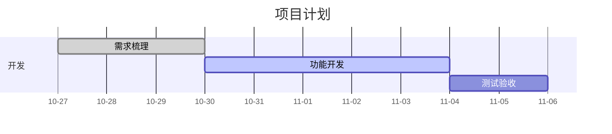

# Markdown 图表

笔记正文和青藜回复中的 `mermaid` 代码块会显示为图表，支持甘特图、流程图、时序图等 Mermaid 图表。代码保存在原文中，点击「编辑正文」即可修改。

例如，将下面内容写进笔记：

````markdown

````

图表跟随白天、夜间和星空主题。较宽的图表可左右滚动，点击图表可放大查看。加载或绘制失败时会保留源码并显示提示，修改源码或刷新页面后可重新绘制。普通代码块仍显示代码。

渲染库随应用打包，已缓存笔记和网页离线资源后可离线查看，Android 使用安装包内的资源。图表按静态图片显示，不执行脚本或点击回调，也不加载外部资源。

完整语法参见 [Mermaid 官方文档](https://mermaid.js.org/intro/)，甘特图语法参见[甘特图文档](https://mermaid.js.org/syntax/gantt.html)。
